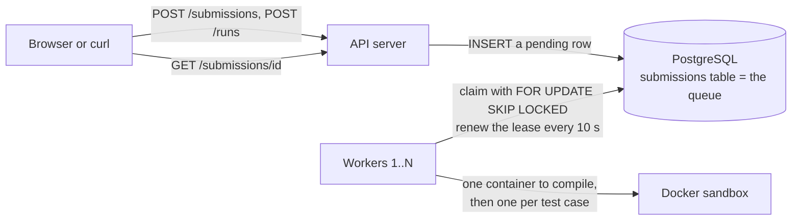

# code_judge

A sandboxed code execution and judging engine, in the style of Codeforces or LeetCode.

- **Sandboxed execution in Go.** Every compile and every run happens in a locked-down Docker container, with per-submission CPU, memory, process and network limits.
- **A PostgreSQL job queue.** Any number of worker processes take jobs safely using row-level locking (`SELECT ... FOR UPDATE SKIP LOCKED`), and leases with heartbeats recover the jobs of workers that crash.
- **A multi-language judge** for C++, Python and Java. Each test case gets a verdict: `AC`, `WA`, `TLE`, `MLE`, `RE` or `CE`.

It comes with a small web page: a **Playground** to run any code on your own input, and **Problems** to submit solutions and see a verdict for each test.

---

## How it works



1. **The API only writes rows.** `POST /submissions` inserts a row with `status = 'pending'` and immediately returns `202 Accepted` with an id. The API never runs code itself.
2. **A worker claims the oldest pending job** in one transaction: `SELECT ... FOR UPDATE SKIP LOCKED`, then an `UPDATE` to `running` with a 30 s lease.
3. **The worker compiles the code once, inside the sandbox**, then runs it on each test case in order, each run in its own container. The first failing test decides the verdict, and the remaining tests are skipped.
4. **The worker renews its lease every 10 s** while it works (the heartbeat). When it finishes, it saves the verdict and the per-test results in one transaction, and only if the job is still its own.
5. **The client polls** `GET /submissions/{id}` until `status` is `done`.

## Design decisions

### 1. PostgreSQL as the queue, made safe with `SKIP LOCKED`
The submissions table *is* the queue, so there's no separate broker to run, and a job and its result live in the same transactional database. This is how a worker claims a job ([internal/store/store.go](internal/store/store.go)):

```sql
BEGIN;
SELECT id, ... FROM submissions
WHERE (status = 'pending' OR (status = 'running' AND lease_expires_at < now()))
  AND retry_count < 3
ORDER BY created_at
LIMIT 1
FOR UPDATE SKIP LOCKED;          -- lock the row; skip rows other workers have locked

UPDATE submissions
SET status = 'running', worker_id = $me,
    lease_expires_at = now() + interval '30 seconds',
    retry_count = retry_count + 1
WHERE id = $claimed;             -- still inside the transaction, so still holding the lock
COMMIT;
```

- **`FOR UPDATE`** locks the chosen row until the transaction ends. **`SKIP LOCKED`** makes other workers pass over it and take the next free row, instead of waiting. So N workers get N different jobs.
- **The `UPDATE` must happen before `COMMIT`.** The lock is released at `COMMIT`. If the row still said `pending` at that point, another worker could claim it in the gap.
- **The race is real.** With the naive version (a separate `SELECT` and `UPDATE`, no lock), 3 workers judged **10 of 24 jobs more than once**. With the locking version: **0 duplicates** with 3 workers × 24 jobs and with 5 workers × 40 jobs. `UNSAFE_CLAIM=1 bash scripts/race.sh` reproduces the bad version side by side.

### 2. Leases and heartbeats for crash recovery
A worker can die mid-job (crash, `kill -9`, power cut). Each claim writes a **lease**, a deadline 30 s away, and the worker's **heartbeat** pushes that deadline forward every 10 s, so two heartbeats can be missed before it runs out.

- **A dead worker's job comes back on its own.** Nobody detects the crash. The heartbeats stop, the lease expires, and the job matches the claim query again (`status = 'running' AND lease_expires_at < now()`).
- **Leases instead of holding the transaction open for the whole job.** A long transaction would pin a database connection and a row lock per running job, and any network blip would abort it. A lease is just a timestamp, so there's nothing to keep open.
- **Ownership checks stop "zombie" workers.** A worker that was only *slow* (frozen, not dead) may wake up after its job was re-claimed. Its heartbeat and its final save both include `WHERE worker_id = $me AND status = 'running'`, so its late result is discarded instead of overwriting the new owner's.
- **Retry cap.** A job that crashes every worker that touches it (a "poison pill") is marked `failed` after 3 attempts instead of looping forever.
- **At-least-once processing.** A job can be *started* twice (once by the crashed worker, once by the new one), but only one result is ever saved. That's safe because judging is deterministic.
- **The database's clock.** All lease times use `now()` from the database, never a worker's own clock, so clock differences between machines don't matter.
- **Tested for real:** `scripts/crash.sh` kills a worker with `kill -9` mid-job, and another worker finishes the job as attempt 2 once the lease runs out.

### 3. The Docker sandbox
A container is a normal Linux process that the kernel restricts. **Namespaces** limit what it can *see*, and **cgroups** limit what it can *use*. Every container is started with ([internal/sandbox/sandbox.go](internal/sandbox/sandbox.go)):

| Flag | Mechanism | Stops |
|---|---|---|
| `--memory=256m --memory-swap=256m` | cgroup memory cap, no swap | memory bombs |
| `--cpus=1` | cgroup CPU quota | hogging every core |
| `--pids-limit=64` | cgroup process cap | fork bombs |
| `--network=none` | empty network namespace | network access |
| `--read-only`, code mounted `:ro`, small `/tmp` tmpfs | mount namespace | tampering with files |
| `--user=65534`, `--cap-drop=ALL`, `--security-opt=no-new-privileges` | not root, no special powers | privilege escalation |
| `--log-driver=none` + output capped at 1 MB | | output floods |

`go test -v -run TestLimits ./internal/sandbox` runs a program that reads these limits from *inside* the container, proving the kernel actually enforces them.

Some details that matter:

- **Killing on timeout uses `docker kill <name>`, not killing our process.** The `docker` command is only a client. The container belongs to the Docker daemon, and killing the client leaves the program running.
- **TLE timing uses Docker's own start and finish timestamps**, so the few hundred milliseconds of container startup don't count against the program. The hard kill comes at limit + 2 s.
- **Exit code 137 means "killed by SIGKILL" (128 + 9),** which is what both the OOM killer and our timeout send. So MLE is decided by Docker's `OOMKilled` flag. Runtimes that refuse an allocation themselves (`MemoryError`, `OutOfMemoryError`, `std::bad_alloc`) also count as MLE.
- **Compiling runs in the sandbox too**, with its own limits (15 s, 1 GB). Code can attack the compiler: `#include "/dev/zero"` makes `g++` read forever, and it gets a CE.
- **Verdict order:** TLE, then MLE, then RE, then WA or AC. The reasons *we* stopped a program come before "it crashed on its own", because a killed program also has a non-zero exit code.

### 4. Run and Submit share one pipeline
The page's **Run** button (your own input, no judging) is a row in the same queue with `mode = 'run'`. It goes through the same workers, the same sandbox, the same leases and the same limits. Only the final step differs: it saves what the program printed instead of comparing it. The judge is split into shared `compile()` and `execute()` steps ([internal/judge/judge.go](internal/judge/judge.go)), so neither path duplicates the other.

## Bugs found while testing (and fixed)
- **A race in OOM detection.** Docker reports "process exited" and "killed for memory" as two separate events, in either order, so occasionally `OOMKilled` was still `false` when we checked, and a memory bomb came out as RE. Fix: if the exit code is 137 and we didn't send the kill, re-check for up to 1 s. It then passed 20 of 20 runs.
- **A fork bomb could hold a worker for 30–40 s.** 64 Python processes fill the memory limit and thrash, and even dying becomes slow. Fix: after asking Docker to kill a container, wait at most 5 s, report TLE, and finish the clean-up in the background. Rule: the worker never waits an unbounded time on untrusted code.
- **Leaked containers when Docker was slow.** A single `docker rm -f` timed out while the daemon was busy, and the error was ignored. Fix: retry removal until the container is gone. Workers also sweep away containers left behind by crashed workers.

## Verification
`bash scripts/checklist.sh` runs the whole checklist end to end:

```
PASS  Valid code -> AC (Python and Java)
PASS  Wrong output -> WA
PASS  Infinite loop -> TLE
PASS  Memory bomb -> MLE
PASS  Syntax error -> CE (C++ and Python)
PASS  All test cases judged; first failure decides (WA on test 3)
PASS  20+ jobs across 3+ workers, each processed exactly once
PASS  Killed worker's job picked up and finished by another worker
```

Go tests: `go test ./...` (needs Docker; `-short` skips the slow ones). `TestVerdicts` judges 20 programs in 3 languages, and the sandbox tests cover limits, timeouts, OOM, output caps and fork bombs. Everything also passes with `-race`.

## Performance and scaling
Measured on a laptop (WSL2): about **1 submission per second per worker**. 3 workers judged 24 single-test submissions in about 8 s. **The bottleneck is starting containers** (one to compile, plus one per test case), not the queue.

How it would scale:
- **The API is stateless**, so you can run copies behind a load balancer.
- **Workers scale out** on more processes or machines, and `SKIP LOCKED` keeps them from colliding. Each sandbox gets 1 CPU, so about one worker per core.
- **The claim query uses a partial index** on unfinished rows only, so it stays fast with millions of finished submissions.
- **Next optimisations:**
  - run all of a submission's tests in one container, or keep warm containers
  - lighter sandboxes such as gVisor or Firecracker
  - only at very large scale, a dedicated queue such as Kafka or SQS, which gives up keeping the queue and the data in one transactional database

**Not hosted publicly, on purpose.** A public service that runs anyone's code needs logins, rate limits and abuse protection, which were outside this project's scope.

## Running it
You need Linux or WSL2 (Ubuntu), Docker, Go 1.22+, and `psql`.

Start Postgres:
```bash
docker run -d --name judge-pg --restart unless-stopped -e POSTGRES_USER=judge -e POSTGRES_PASSWORD=judge -e POSTGRES_DB=judge -p 5432:5432 -v judge-pgdata:/var/lib/postgresql/data postgres:17
```
Load the database URL:
```bash
set -a; source .env.example; set +a
```
Create the tables:
```bash
for f in migrations/*.sql; do psql "$DATABASE_URL" -f "$f"; done
```
Download the language images:
```bash
docker pull python:3.13-slim && docker pull gcc:14 && docker pull eclipse-temurin:21-jdk
```
Start everything (the API, 2 workers and the sample problems), then open http://localhost:8080:
```bash
bash scripts/web.sh
```

On Windows you can instead double-click **`start.cmd`**, which runs the same thing inside WSL.

| Script | What it does |
|---|---|
| `scripts/web.sh` | API, workers and sample problems, for the web page (`WORKERS=3` for more workers) |
| `scripts/demo.sh` | Submits programs from `testdata/` and prints their verdicts |
| `scripts/race.sh` | 24 jobs on 3 workers, then checks for duplicates (`CLAIM_DELAY_MS=200`, `UNSAFE_CLAIM=1`) |
| `scripts/crash.sh` | Kills a worker mid-job and watches another one recover the job |
| `scripts/checklist.sh` | Runs the full verification checklist |

## API
| Method and path | Body | Returns |
|---|---|---|
| `POST /problems` | `{title, statement, time_limit_ms, memory_limit_mb, test_cases: [{input, expected_output}]}` | `{problem_id}` |
| `GET /problems` | | the problems, each with its first test as an example |
| `POST /submissions` | `{problem_id, language, source_code}` with `cpp`, `python` or `java` | `202 {submission_id}` |
| `POST /runs` | `{problem_id (optional), language, source_code, input}` | `202 {submission_id}` |
| `GET /submissions/{id}` | | `{status, mode, verdict, runtime_ms, message, stdout, tests: [{test, verdict, runtime_ms}]}` |

To add a problem, put a `problem.json` in `testdata/<name>/` (see [testdata/sum/problem.json](testdata/sum/problem.json)), and `web.sh` loads it on the next start.

## Project layout
```
cmd/api/            HTTP server (serves the API and the web page)
cmd/worker/         worker process: claim, heartbeat, judge, save
internal/store/     every SQL query (the queue lives here)
internal/worker/    the worker loop, heartbeats, retry cap, clean-up
internal/judge/     languages, compile/execute, verdicts, output comparison
internal/sandbox/   the Docker sandbox: limits, kill, inspect, clean-up
internal/api/       HTTP handlers
web/                the single-page front end (compiled into the API binary)
migrations/         SQL schema, applied in order
testdata/           sample problems and programs for every verdict
scripts/            demo, race, crash and checklist scripts
```
